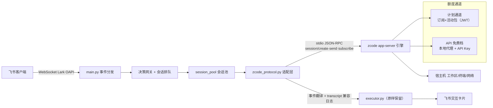

# 🚀 ZCode Feishu Bot

<div align="center">


-purple?style=flat-square)


</div>

**飞书 × ZCode 引擎的企业级全能智能研发助手。**
本项目是上游项目的 **100% 功能移植版**：将原引擎完整替换为 **ZCode 引擎**（通过 ZCode Protocol stdio 协议直驱），并新增了**账户套餐总览与一键切换**等能力。

无需公网 IP 或 Webhook 回调，在飞书里即可远程驱动本机完成：全栈代码读写、智能终端执行、多模态音视频解析、定时任务、语音双向交互、智能家居控制 —— 额度直接消耗你的 **Z.ai 订阅 / 活动资源包**（与 ZCode 桌面版同一通道）。

---

## 🌟 核心特性

### 🧠 引擎与额度
- **计划通道直连**：直接消耗 Z.ai Start Plan / 1024 Dev Day 等订阅与活动额度（GLM-5.3 / GLM-5.3-Flash 旗舰模型），与 ZCode 桌面版吃同一个池子
- **`/plan` 套餐总览**：列出账户全部套餐（付费/免费/活动），含每个模型的**额度扣减链**（优先级顺序）、进度条、有效期倒计时，一键切换
- **自适应思考档位**：按任务复杂度自动调度 低/中/高 推理档（闲聊秒回省额度，复杂工程深度思考）；也可在 `/model` 面板手动锁定档位
- **API Key 免费档后备**：可选配置 Coding Plan API Key 走免费通道（内置本地流式代理，不消耗套餐额度）
- **System One (Jev) 决策网关**：毫秒级前置安全拦截 + 意图分类，未配置 Key 时自动降级本地规则引擎（~0.05ms）

### 💬 飞书原生体验
- **秒级响应卡片**：消息送达即下发打字机卡片，任务排队/工具执行/步骤推进全生命周期原地刷新
- **会话独立排队**：按会话隔离任务队列，`/stop` 紧急熔断；上下文预热池消除冷启动
- **多模态双向**：图片 / PDF / Word / 音视频进，生成物（图表/文档/压缩包）自动回传；语音条自动转写 + Edge-TTS 语音回复

### 🧩 生态与运维
- **动态插件总线**：热加载/热重载，`before_ai / after_ai / on_command / on_card_action` 生命周期钩子
- **开箱插件**：Cron 定时调度、Notes 备忘、AI Memory 长期记忆、插件商店、系统 OTA 自升级（+ 可选的 Home Assistant / 树莓派 GPIO / Passport 硬件插件）
- **三档授权体系**：首个私聊用户自动成为管理员；`/auth` 申请 → 管理员一键审批（Basic/Dev/Full）；防刷限流
- **PM2 守护**：一键部署、崩溃自动拉起、开机自启

---

## ⌨️ 指令一览

| 分类 | 指令 | 说明 |
|---|---|---|
| 🎫 套餐 | `/plan` | **账户全部套餐总览**（额度扣减链/有效期/进度条），按套餐一键切换 |
| 🎛 模型 | `/model` `/card` `/menu` | 模型面板（GLM-5.3 / Flash × 低中高三档热切换） |
| 🧠 记忆 | `/context` `/memory` `/brain` `/clear` | 上下文看板 / 个人偏好 / 全局记忆 / 清空会话 |
| 📁 工程 | `/project` `/note` `/quota` `/status` | 工作区管理 / 备忘录 / 账户额度 / 进程状态 |
| ⚡ 系统 | `/help` `/stop` `/update` `/ping` `/auth` `/user` `/s1` | 帮助大厅 / 熔断 / OTA / 探活 / 授权 / 用户管理 / 决策网关 |
| 🧩 插件 | `/plugins` `/cron` `/passport` `/stat` | 插件中心 / 定时任务 / 硬件 / 树莓派指标 |

---

## 🏗 架构



**移植关键点**（详见 [bot/README.md](bot/README.md)）：
- 上游 `stream-json` 长驻进程 → `zcode app-server`（ZCode Protocol）长驻进程，事件实时翻译，executor/卡片/指令层零改动
- 每轮对话写上游格式兼容的 transcript 日志，上下文看板/选项卡/任务追踪原样可用
- 模型映射：`glm-5.3[-flash]-low/medium/high` → 引擎 reasoningLevel `low/high/max`
- 认证：适配器扮演"宿主"角色 — 推送 entitlement 配置（模型物化）+ 按通道应答凭证（计划通道 JWT / API 通道 Key），引擎自行完成 V4 请求签名过服务端风控

---

## 🚀 快速开始

### 环境要求

- macOS 或 Linux
- **ZCode 桌面版**（已登录 Z.ai 账号）或独立 zcode CLI —— 引擎与计划额度的来源
- **Node.js 18+**（引擎运行时）
- **Python 3.10+**（脚本自动探测 brew/apt 安装的新版本）

### 一键部署

```bash
git clone https://github.com/Level6me/zcode-feishu-bot.git
cd zcode-feishu-bot/bot
bash install.sh
```

脚本自动完成：环境探测 → venv 与依赖（失败自动切清华镜像）→ 本地代理自签证书 → 飞书凭证配置（首次交互式询问）→ 免费档通道注册（可选）→ 引擎登录检查 → **PM2 启动 + 飞书连接健康检查**。

```bash
bash install.sh status     # 运行状态
bash install.sh restart    # 重启
bash install.sh stop       # 停止
bash install.sh uninstall  # 注销服务（保留源码与配置）
```

无 PM2 时自动降级 nohup 后台运行（日志 `bot/run.log`）。

### 飞书后台配置（4 步，一次性）

1. [飞书开放平台](https://open.feishu.cn/) 创建企业自建应用
2. **事件与回调** → 接收方式切换为 **WebSocket 长连接**
3. 权限：`im:message` `im:message:resource` `im:image` `im:message.reaction` `im:chat:readonly` `contact:user.base:readonly`；订阅事件 `im.message.receive_v1`
4. 发布版本 → 给机器人发第一条私聊消息（**自动成为管理员**）

---

## ⚙️ 配置（bot/.env）

```ini
# 飞书凭证（必填）
FEISHU_APP_ID=cli_xxx
FEISHU_APP_SECRET=xxx

# 模型与通道
DEFAULT_MODEL=glm-5.3-flash-high        # 默认模型（低/中/高三档后缀）
ZCODE_PROVIDER_ID=account:zai-start-plan
ZCODE_API_KEY=                           # 可选：Coding Plan API Key（免费档后备通道）

# 工作区
WORKSPACE_ROOT=~                         # 项目浏览器根目录

# 语音
ENABLE_VOICE_REPLY=true
TTS_VOICE=zh-CN-XiaoxiaoNeural

# System One 决策网关（可选，留空自动本地规则兜底）
TYPESAFE_API_KEY=
```

### 模型命名规则

| 面板/配置写法 | 引擎实际调用 |
|---|---|
| `glm-5.3-flash-low` | GLM-5.3-Flash · reasoningLevel `low` |
| `glm-5.3-flash-medium` | GLM-5.3-Flash · `high` |
| `glm-5.3-flash-high` | GLM-5.3-Flash · `max` |
| `glm-5.3-low/medium/high` | GLM-5.3 同上三档 |
| `apifree:glm-4.7-flash` | 强制 API 免费档通道 |

### 额度扣减机制

套餐额度按**模型**消耗，服务端按优先级自动选桶（`/plan` 面板会展示每个模型的完整扣减链）。例如：

```
GLM-5.3-Flash: 👉 1024 Dev Day(3亿) → ⏭️ Start Plan 每日(500万/天)
GLM-5.3:       ⚪ Start Plan 每日(耗尽,次日重置) → 👉 1024 Dev Day(余量)
```

---

## 🧩 插件生态

内置插件位于 `bot/plugins/`，在飞书 `/plugins` 面板可启停/热重载；`plugin_sources.json` 可添加第三方仓库。二次开发继承 `plugin_base.BasePlugin`，实现生命周期钩子即可。

## 🛠 排错

| 症状 | 处理 |
|---|---|
| `zcode 引擎未找到` | 安装 ZCode 桌面版并登录，或 `.env` 设置 `ZCODE_BIN` |
| 回复卡片提示"引擎尚未登录" | 打开 ZCode 桌面版登录，或 `bash bot/engine_login.sh` |
| `/plan` 无数据 | 保持 ZCode 桌面版运行（计费数据由桌面端实时刷新） |
| 模型回复报额度错误 | `/plan` 查看余量，切换套餐或 `/model` 换轻量档 |
| 想用 API 免费档 | `bash bot/engine_apikey.sh <Key>`（[获取 Key](https://z.ai/manage-apikey/apikey-list)） |
| 消息无响应 | `bash install.sh status`；`pm2 logs zcode-feishu-bot`；确认单实例运行 |
| 会话级日志 | `~/.zcode/feishu-brain/<sessionId>/.system_generated/logs/transcript.jsonl` |

---

## 📂 目录结构

```
zcode-feishu-bot/
├── .zcode-plugin/plugin.json      # ZCode 插件清单
├── skills/feishu-bot/SKILL.md     # 运维技能（ZCode 内可直接对话运维）
├── marketplace.json               # 本地插件市场清单（同级）
└── bot/
    ├── main.py                    # 入口（飞书 WS + 事件分发）
    ├── zcode_protocol.py          # ★ 引擎适配层（协议客户端/事件翻译/凭证应答）
    ├── session_pool.py            # 引擎会话池（预热/复用/热切模型）
    ├── executor.py                # 执行器（流式卡片/看门狗/重试）
    ├── api_proxy.py               # 本地 HTTPS 流式代理（免费档通道）
    ├── install.sh                 # ★ 一键部署
    ├── engine_login.sh            # 引擎 OAuth 登录辅助
    ├── engine_apikey.sh           # API Key 一键配置
    ├── commands.py / cards/ / handlers/ / plugins/ / utils/ ...
    └── run.log                    # 运行日志
```

## 🙏 致谢与许可

- 上游项目：[Level6me/antigravity-feishu-bot](https://github.com/Level6me/antigravity-feishu-bot)（MIT）
- 本移植沿用 MIT License，新增模块同样开源
