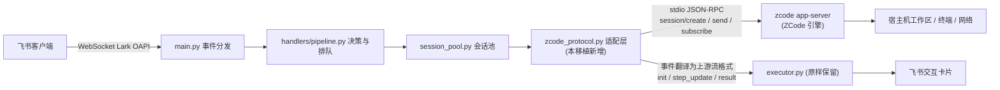

# 🚀 ZCode Feishu Bot

<div align="center">


-purple?style=flat-square)
-teal?style=flat-square)


</div>

基于飞书原生 WebSocket 长连接与本机 **ZCode（zcode）引擎** 的企业级全能智能研发与运维助手。
本项目是上游项目的 **100% 功能移植版**：将原引擎完整替换为 `zcode` 引擎（通过 ZCode Protocol stdio app-server 协议驱动），其余功能（卡片、指令、权限、插件、定时、语音、多模态、System One 决策网关）全部保留。

无需公网 IP 或 Webhook 回调配置，在飞书内即可直接远程驱动本机完成全栈代码读写、智能终端命令执行、多模态音视频解析、长效偏好记忆与任务自动化规划。

---

## 🧩 移植架构（与原版的差异点）



移植要点：

1. **引擎替换**：上游 `--input-format stream-json` 长驻进程 → `zcode app-server`（ZCode Protocol）长驻进程。
   `zcode_protocol.py` 负责请求/事件双向翻译，executor / 卡片 / 指令层 **零改动**。
2. **Transcript 兼容日志**：适配层将每轮对话写入 `~/.zcode/feishu-brain/<session>/.system_generated/logs/transcript.jsonl`
   （上游格式兼容），因此上下文看板、ask_question 选项卡、后台任务追踪等原有能力全部可用。
3. **模型映射**：`/model` 面板展示 `glm-5.3 / glm-5.3-flash / glm-5.2 / glm-5-turbo`，
   后缀 `-low/-medium/-high` 自动映射为引擎 reasoningLevel `low/high/max`；
   订阅通道默认 `account:zai-start-plan`（可用 `ZCODE_PROVIDER_ID` 覆盖）。
4. **权限沙箱**：原 `--dangerously-skip-permissions` → 引擎 yolo 模式（仅管理员）；
   原受限用户 `--sandbox` → 引擎 build 模式 + `Bash/Task` 工具黑名单。
5. **账户与额度**：`/quota` 改为展示 zcode 引擎登录账号（自动解密 `~/.zcode/v2/credentials.json`）、
   引擎版本与 Z.ai 控制台跳转；额度耗尽识别同样保留。
6. **守护进程**：上游保活守护重写为 `zcode_daemon.py`（引擎保活探测）。

其余模块（System One Jev 决策网关 + 本地规则兜底、HMDM 数学决策模型、三档授权体系、
防刷限流、插件总线与插件商店、Cron 引擎、语音双向、生成物回传、OTA 自升级）与上游保持一致。

---

## ⌨️ 指令清单

与上游一致：`/help /model /context /memory /brain /clear /project /note /quota /status /stop /update /ping /auth /user /plugins /cron /s1 /passport /stat` 等，详见上游 README。

---

## 🚀 安装部署

### 环境要求
- Linux 或 macOS，**Python 3.10+**，**Node.js**（zcode 引擎运行时），PM2（生产守护）
- 已安装 **ZCode**（Desktop 版自动探测 `/Applications/ZCode.app/Contents/Resources/glm/zcode.cjs`，或 zcode CLI）
- **一次性引擎登录**：`zcode login zai`（浏览器完成 Z.ai 授权，激活 Coding Plan 模型通道）

### 一键安装（推荐）

```bash
cd bot
bash install.sh            # 一键部署到可用状态（幂等，可重复执行；首次会询问飞书凭证）
bash install.sh status     # 查看运行状态
bash install.sh stop       # 停止
bash install.sh restart    # 重启
bash install.sh uninstall  # 停止并注销（保留源码与 .env）
```

install.sh 自动完成：环境探测（zcode 引擎 / Node / Python 3.10+）→ venv 创建与依赖安装（失败自动切清华镜像）→ 本地代理自签证书 → .env 配置 → API 免费档 provider 注册（若配置了 ZCODE_API_KEY）→ 引擎登录检查 → PM2/nohup 启动 → 飞书 WS 连接健康检查。

### 手动部署

```bash
cd bot
python3 -m venv venv && source venv/bin/activate
pip install -r requirements.txt
cp .env.example .env    # 填入飞书凭证
pm2 start venv/bin/python3 --name zcode-feishu-bot -- main.py
```

### 飞书后台配置（4 步）

1. 开发配置 → 事件与回调 → **WebSocket 长连接** 模式
2. 权限：`im:message`、`im:message:resource`、`im:image`、`im:file`、`im:message.reaction`、`im:chat:readonly`、`contact:user.base:readonly`
3. 订阅事件：`im.message.receive_v1`（卡片回调自动支持）
4. 版本管理与发布 → 创建版本并发布

---

## ⚙️ 环境变量（差异部分）

```env
# zcode 引擎
ZCODE_BIN=              # 留空自动探测（PATH / ZCode.app / ~/.zcode）
ZCODE_NODE_BIN=         # 运行 zcode.cjs 的 node（默认 PATH 中的 node）
ZCODE_HOME=             # 默认 ~/.zcode
ZCODE_PROVIDER_ID=account:zai-start-plan
ZCODE_MODEL_ID=GLM-5.3
DEFAULT_MODEL=glm-5.3-flash-high
```

其余变量（飞书凭证、白名单、TypeSafe、TTS、超时阈值）与上游一致，见 `.env.example`。

---

## 🛠️ 排错

| 症状 | 处理 |
| --- | --- |
| 卡片提示 `zcode 引擎未找到` | 安装 ZCode 或在 `.env` 设置 `ZCODE_BIN` |
| `Select a model before continuing` / 模型面板为空 | 执行一次 `zcode login zai` 并 `pm2 restart zcode-feishu-bot` |
| 飞书连接不上 | 核对 AppID/Secret、事件模式为 WebSocket 长连接、应用已发布 |
| 查看会话日志 | `~/.zcode/feishu-brain/<sessionId>/.system_generated/logs/transcript.jsonl` |

---

## 📄 许可证

沿用上游 MIT License。
